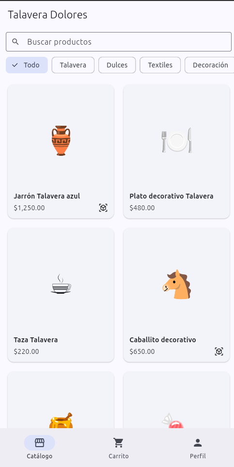
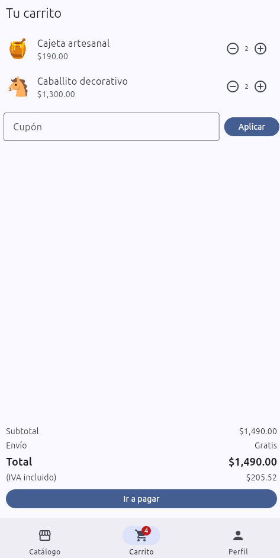
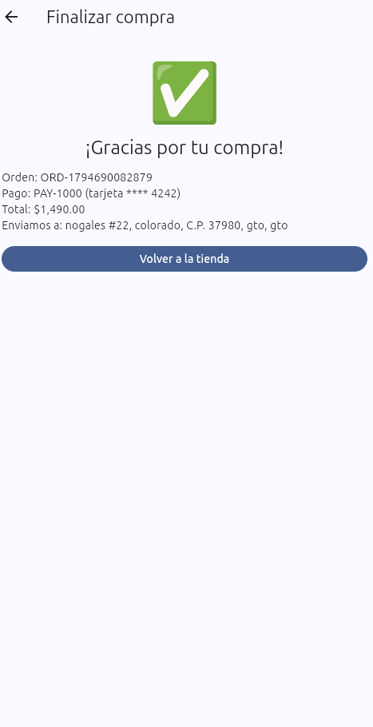
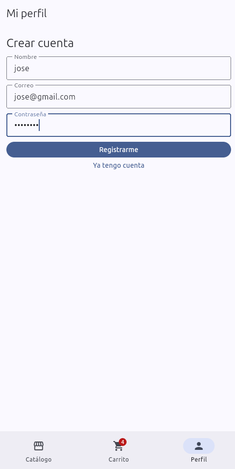
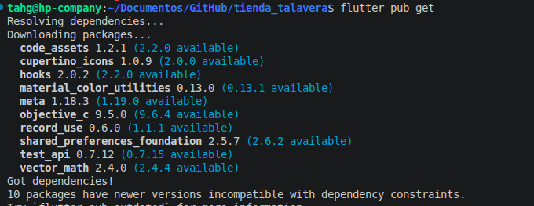
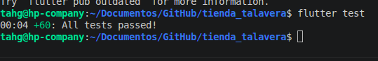

# tienda_talavera

A new Flutter project.

## Getting Started

This project is a starting point for a Flutter application.

A few resources to get you started if this is your first Flutter project:

- [Learn Flutter](https://docs.flutter.dev/get-started/learn-flutter)
- [Write your first Flutter app](https://docs.flutter.dev/get-started/codelab)
- [Flutter learning resources](https://docs.flutter.dev/reference/learning-resources)

For help getting started with Flutter development, view the
[online documentation](https://docs.flutter.dev/), which offers tutorials,
samples, guidance on mobile development, and a full API reference.

# 🏺 Talavera Dolores — Tienda móvil con TDD y Realidad Aumentada

App de e-commerce en **Flutter** para artesanías de Dolores Hidalgo, desarrollada paso a paso con **TDD** (Test-Driven Development).
Incluye catálogo, carrito, checkout con pasarela simulada, perfil de usuario y "Ver en tu espacio" (AR con `model_viewer_plus`).

> **Materia:** Desarrollo Móvil Integral · UTNG
> **Profesor:** Anastacio Rodríguez García
> **Alumno:** Jose Emmanuel Garcia Calvillo

⚠️ La pasarela de pagos y el servidor de cuentas son **simulados**. No se procesa dinero real.

---

## 📸 Capturas

| Catálogo / Vista final | Carrito |
|:---:|:---:|
|  |  |

| Compra | Perfil |
|:---:|:---:|
|  |  |

| Dependencias | Pruebas en verde |
|:---:|:---:|
|  |  |

---

## ✨ Funcionalidades

- **Catálogo** con búsqueda, filtro por categoría y filtro "Solo AR".
- **Carrito** con límite de 10 por producto, control de existencias, cupones (`DOLORES10`, `TALAVERA15`) y envío gratis desde $800.
- **Checkout** en 3 pasos (dirección → pago → confirmación) con revalidación de precios.
- **Pagos seguros (simulados):** algoritmo de Luhn, detección de marca, vigencia, CVV, tokenización e **idempotencia** (nunca cobra dos veces).
- **Cuentas:** sal + hash, mensajes genéricos de error, bloqueo tras 5 intentos fallidos, token en almacenamiento seguro.
- **Perfil:** dirección de envío, favoritos e historial de compras.
- **Ver en tu espacio:** visor 3D y AR (Scene Viewer en Android, AR Quick Look en iOS).
- Dinero en **centavos enteros** (sin errores de `double`), IVA incluido.

## 🧱 Arquitectura

lib/
dominio/ # reglas del negocio (Dart puro, sin Flutter)
datos/ # implementaciones: memoria, shared_preferences, secure storage
presentacion/
vm/ # ViewModels (ChangeNotifier)
pantallas/ # catálogo, detalle, AR, carrito, checkout, perfil
dependencias.dart # raíz de composición
main.dart
test/ # dominio_test, servicios_test, viewmodels_test


Las dependencias apuntan siempre hacia el dominio, que solo conoce *contratos* (clases abstractas).

## 🛠️ Tecnologías

- Flutter / Dart 3
- `model_viewer_plus` · `shared_preferences` · `flutter_secure_storage` · `crypto`

## 🚀 Instalación y ejecución (Linux)

```bash
# dependencias del sistema para flutter_secure_storage
sudo apt install -y libsecret-1-dev libjsoncpp-dev

git clone <URL_DEL_REPOSITORIO>
cd tienda_talavera
flutter pub get
flutter test
flutter run -d linux        # o -d <id_del_celular> (ver: flutter devices)
```

> La **AR solo funciona en teléfono físico** compatible con ARCore (Android) o iPhone. En escritorio/emulador no está disponible.

## 🧪 Pruebas

```bash
flutter test
```

Cubren dinero, producto, carrito, validadores, tarjeta, pasarela (idempotencia), checkout, bloqueo de intentos, autenticación y ViewModels.

## 💳 Tarjetas de prueba

| Número | Resultado |
|---|---|
| `4242 4242 4242 4242` | Aprobada |
| `4000 0000 0000 0002` | Rechazada por el banco |
| `4000 0000 0000 9995` | Fondos insuficientes |

Usa cualquier fecha futura (ej. `12/30`) y CVV `123`.